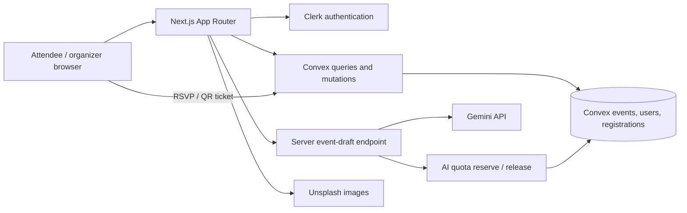

# Spott architecture and decisions

## Request path

## Boundaries

- Next.js renders public discovery/event pages and organizer dashboards. Clerk identifies the signed-in person; Convex enforces ownership and event limits.
- AI event text is an editable draft. It must not publish automatically and must be reviewed by the organizer for factual accuracy.
- Ticket price fields are informational. Payments occur outside Spott; the app does not collect card data or promise refunds/payouts.
- Attendee names/emails and registrations are stored in Convex. Use synthetic records in demos; set approved retention, deletion and privacy policy before using real event lists.
- `ENTITLEMENT_SIGNING_SECRET` must match between Next.js and Convex and must remain server-side. Production credentials belong in provider secret stores, never in the repository.

## ADR-001: individual organizer subscription, no ticket payments

**Decision:** Keep the optional Clerk Pro entitlement at an individual organizer level; ticket transactions remain outside the product. Configure price only in the owner-controlled Clerk dashboard after demand validation.

**Reason:** Current implementation supports organizer event quotas, not marketplace payouts, tax handling, refunds or dispute management. Claiming ticket-payment support would be misleading and add material risk.

**Trade-offs:** Users need a separate payment path for paid events, and teams do not share one subscription. Revisit only after organizer interviews and finance/legal review.

## Operations and failure recovery

- Keep backend event limits on the server; client flags are never entitlement proof.
- AI-generation quotas reserve before provider calls and release on bounded failures; stale reservations expire.
- Verify Convex indexes and auth rules before production data. Configure provider backups, recovery, uptime alerts and rollback before launch; this is not proven by a local build.
- Follow `README.md` for Clerk, Convex, Gemini, Unsplash and site URL setup. Never enable indexing before the real canonical HTTPS URL is configured.
